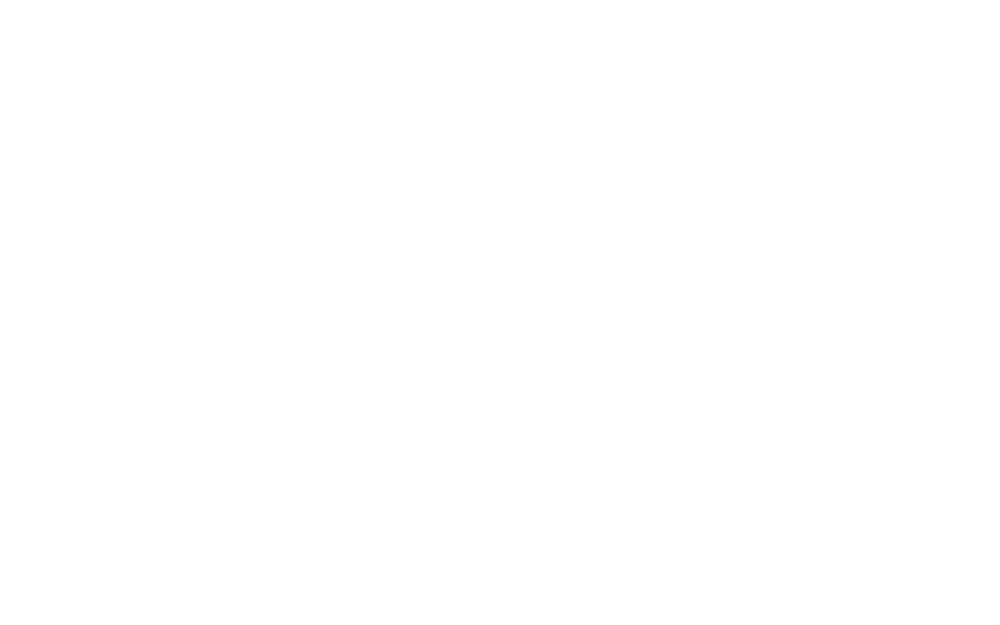

# AI Recipe App 🤖🍳

An intelligent recipe generation application powered by artificial intelligence that creates personalized recipes based on available ingredients, dietary preferences, and cooking constraints.

**Download:** [latest release](https://github.com/alexalghisi/ai-recipe-app/releases/latest)



## Overview

The AI Recipe App leverages advanced AI technologies to help users discover new recipes, reduce food waste, and make cooking more accessible and enjoyable. Simply input your available ingredients, select your preferences, and let AI create the perfect recipe for you.

## Features ✨

- **AI-Powered Recipe Generation**: Generate unique recipes using advanced language models
- **Ingredient-Based Search**: Input available ingredients and get recipe suggestions
- **Dietary Preferences**: Support for vegetarian, vegan, gluten-free, keto, and other dietary restrictions
- **Cuisine Selection**: Choose from various cuisine types (Italian, Mexican, Asian, etc.)
- **Cooking Time Filters**: Find recipes based on available cooking time
- **Nutritional Information**: View detailed nutritional facts for generated recipes
- **Recipe Saving**: Save favorite recipes for future reference
- **Smart Substitutions**: Get ingredient substitution suggestions
- **Step-by-Step Instructions**: Clear, detailed cooking instructions
- **Responsive Design**: Works seamlessly on desktop, tablet, and mobile devices

## Technologies Used 🛠️

- **Frontend**: React.js, JavaScript (ES6+), HTML5, CSS3
- **AI Integration**: OpenAI API / Custom AI Models
- **State Management**: React Hooks (useState, useEffect, useContext)
- **Styling**: CSS Modules / Styled Components
- **HTTP Client**: Axios / Fetch API
- **Build Tool**: Create React App
- **Deployment**: Vercel / Netlify / GitHub Pages

## Installation & Setup 🚀

### Prerequisites

- Node.js (v16.0 or higher)
- npm or yarn package manager
- AI API key (OpenAI, Hugging Face, or custom API)

### Getting Started

1. **Clone the repository**
   ```bash
   git clone https://github.com/alexalghisi/ai-recipe-app.git
   cd ai-recipe-app
   ```

2. **Install dependencies**
   ```bash
   npm install
   # or
   yarn install
   ```

3. **Environment Configuration**

   Create a `.env` file in the root directory:
   ```env
   REACT_APP_API_KEY=your_ai_api_key_here
   REACT_APP_API_BASE_URL=https://api.openai.com/v1
   REACT_APP_MODEL_NAME=gpt-3.5-turbo
   ```

4. **Start the development server**
   ```bash
   npm start
   # or
   yarn start
   ```

5. **Open your browser**

   Navigate to `http://localhost:3000` to view the application.

## Available Scripts 📜

In the project directory, you can run:

### `npm start`

Runs the app in development mode. Open [http://localhost:3000](http://localhost:3000) to view it in your browser. The page will reload when you make changes.

### `npm test`

Launches the test runner in interactive watch mode. See the section about [running tests](https://facebook.github.io/create-react-app/docs/running-tests) for more information.

### `npm run build`

Builds the app for production to the `build` folder. It correctly bundles React in production mode and optimizes the build for the best performance.

### `npm run eject`

**Note: this is a one-way operation. Once you `eject`, you can't go back!**

If you aren't satisfied with the build tool and configuration choices, you can `eject` at any time.

## Project Structure 📁

```
ai-recipe-app/
├── public/
│   ├── index.html
│   ├── favicon.ico
│   └── manifest.json
├── src/
│   ├── components/           # Reusable UI components
│   │   ├── RecipeDetail/
│   │   ├── RecipeCard/
│   ├── hooks/               # Custom React hooks
│   │   └── useFavorites.js
│   ├── services/            # API services
│   │   ├── openaiRecipeAPI.js
│   │   └── recipeAPI.js
│   │   └── mockRecipeAPI.js
│   ├── styles/              # CSS files
│   │   ├── App.css
│   │   └── components/
│   ├── App.js              # Main App component
│   ├── index.js            # Entry point
│   └── index.css           # Global styles
├── .env                    # Environment variables
├── .gitignore
├── package.json
├── README.md
└── yarn.lock / package-lock.json
```

## Usage Guide 📖

### Basic Recipe Generation

1. **Enter Ingredients**: Add the ingredients you have available
2. **Set Preferences**: Choose dietary restrictions, cuisine type, and cooking time
3. **Generate Recipe**: Click "Generate Recipe" to create your personalized recipe
4. **View Results**: Review the generated recipe with ingredients, instructions, and nutritional info
5. **Save or Share**: Save favorites or share recipes with friends

### Advanced Features

#### Ingredient Substitutions
- Click on any ingredient to see possible substitutions
- Perfect for accommodating allergies or missing ingredients

#### Nutritional Tracking
- View calorie count, macronutrients, and dietary information
- Filter recipes by nutritional requirements

#### Recipe History
- Access previously generated recipes
- Mark favorites for quick access

## API Integration 🔗

The app integrates with AI services to generate recipes. Current supported APIs:

- **OpenAI GPT**: For natural language recipe generation
- **Nutritionix**: For nutritional information
- **Spoonacular**: For recipe data and ingredient information

### API Response Format

```json
{
  "recipe": {
    "title": "Generated Recipe Name",
    "description": "Brief description of the recipe",
    "ingredients": [
      {
        "name": "ingredient name",
        "amount": "quantity",
        "unit": "measurement unit"
      }
    ],
    "instructions": [
      "Step 1: Detailed instruction",
      "Step 2: Next step"
    ],
    "nutrition": {
      "calories": 350,
      "protein": "15g",
      "carbs": "45g",
      "fat": "12g"
    },
    "cookingTime": "30 minutes",
    "servings": 4
  }
}
```

## Configuration ⚙️

### Environment Variables

| Variable | Description | Required |
|----------|-------------|----------|
| `REACT_APP_API_KEY` | AI service API key | Yes |
| `REACT_APP_API_BASE_URL` | Base URL for AI API | Yes |
| `REACT_APP_MODEL_NAME` | AI model identifier | No |
| `REACT_APP_MAX_INGREDIENTS` | Maximum ingredients allowed | No |

### Customization

You can customize the app by modifying:

- **AI Prompts**: Edit prompts in `src/services/aiService.js`
- **Recipe Templates**: Modify recipe formats in `src/utils/recipeHelpers.js`
- **Styling**: Update CSS files in `src/styles/`
- **Components**: Add or modify components in `src/components/`

## Deployment 🌐

### Build for Production

```bash
npm run build
```

This creates a `build` folder with production-ready files.

### Deploy to Vercel

1. Install Vercel CLI: `npm i -g vercel`
2. Run: `vercel`
3. Follow the deployment prompts

### Deploy to Netlify

1. Build the project: `npm run build`
2. Drag the `build` folder to Netlify's deploy interface
3. Configure environment variables in Netlify dashboard

### Deploy to GitHub Pages

1. Install gh-pages: `npm install --save-dev gh-pages`
2. Add to package.json:
   ```json
   "homepage": "https://alexalghisi.github.io/ai-recipe-app",
   "scripts": {
     "predeploy": "npm run build",
     "deploy": "gh-pages -d build"
   }
   ```
3. Run: `npm run deploy`

## Contributing 🤝

Contributions are welcome! Please feel free to submit a Pull Request.

### Development Workflow

1. Fork the repository
2. Create a feature branch: `git checkout -b feature/amazing-feature`
3. Make your changes and commit: `git commit -m 'Add amazing feature'`
4. Push to the branch: `git push origin feature/amazing-feature`
5. Open a Pull Request

### Code Style

- Use ESLint and Prettier for code formatting
- Follow React best practices and hooks patterns
- Write meaningful commit messages
- Add comments for complex logic
- Ensure responsive design for all components

## Testing 🧪

```bash
# Run all tests
npm test

# Run tests with coverage
npm test -- --coverage

# Run tests in watch mode
npm test -- --watch
```

## Troubleshooting 🔧

### Common Issues

**API Key Errors**
- Ensure your API key is correctly set in the `.env` file
- Verify the API key has sufficient credits/permissions

**Build Failures**
- Clear node_modules: `rm -rf node_modules && npm install`
- Check for Node.js version compatibility

**Recipe Generation Issues**
- Verify API endpoints are accessible
- Check network connectivity
- Review API rate limits

## License 📄

This project is licensed under the MIT License - see the [LICENSE](LICENSE) file for details.

## Acknowledgments 🙏

- OpenAI for providing powerful language models
- Create React App for the initial project setup
- The open-source community for inspiration and resources
- Contributors who help improve this project

## Support 💬

If you encounter any issues or have questions:

- Open an [issue](https://github.com/alexalghisi/ai-recipe-app/issues) on GitHub
- Check the [documentation](https://github.com/alexalghisi/ai-recipe-app/wiki)
- Contact: [your-email@example.com]

---

**Happy Cooking with AI! 🤖👨‍🍳**